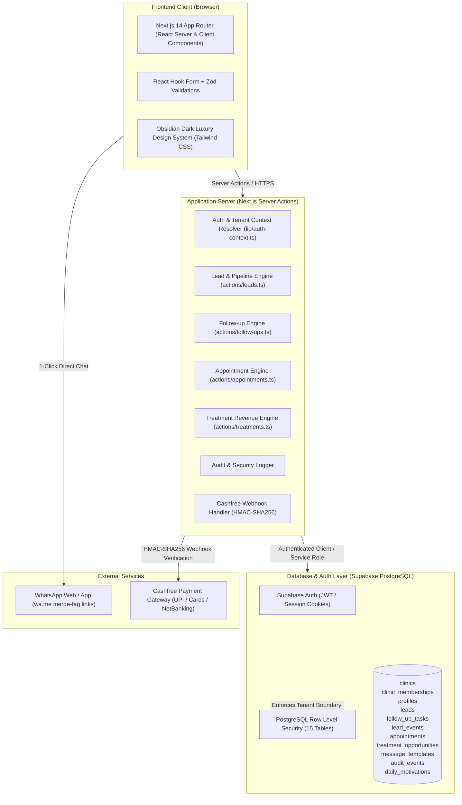

# MolarMetric — Dental Practice Revenue Recovery & Clinical CRM Operating System

[](https://github.com/lingangguliguli/MolarMetric/actions/workflows/ci.yml)
[](https://molarmetric.vercel.app/)
[](https://nextjs.org/)
[](https://www.typescriptlang.org/)
[](https://supabase.com/)
[](https://vitest.dev/)

> **Live Production Deployment**: [https://molarmetric.vercel.app/](https://molarmetric.vercel.app/)  
> **GitHub Repository**: [https://github.com/lingangguliguli/MolarMetric](https://github.com/lingangguliguli/MolarMetric)  
> **Course / Academic Evaluation**: End-Term Software Project Submission  
> **Submission Deadline**: 27 October 2026, 11:59 PM IST  

---

## 📋 Table of Contents
1. [Project Overview & Problem Statement](#-project-overview--problem-statement)
2. [Target Users & Personas](#-target-users--personas)
3. [The Solution: MolarMetric OS](#-the-solution-molarmetric-os)
4. [Core Features & Application Logic](#-core-features--application-logic)
5. [System Architecture & Data Model](#-system-architecture--data-model)
6. [Engineering Decisions & Technical Depth](#-engineering-decisions--technical-depth)
7. [Security & Compliance](#-security--compliance)
8. [Technology Stack](#-technology-stack)
9. [Local Development & Setup Guide](#-local-development--setup-guide)
10. [Environment Variables](#-environment-variables)
11. [Testing & Quality Assurance](#-testing--quality-assurance)
12. [Live Deployment](#-live-deployment)
13. [Demo Video & Walkthrough Guide](#-demo-video--walkthrough-guide)

---

## 🎯 Project Overview & Problem Statement

### The Problem
Private dental practices and multi-chair dental clinics in India operate in an intensely competitive environment. High-ticket clinical procedures—such as **Dental Implants (₹25,000–₹65,000 per tooth)**, **Clear Aligners / Orthodontics (₹60,000–₹2,50,000)**, **Full-Mouth Rehabilitations**, and **Cosmetic Veneers**—account for up to 70% of a clinic's net profit.

However, dental clinics face severe revenue leakage:
1. **Multi-Channel Inquiry Chaos**: Enquiries arrive haphazardly across phone calls, WhatsApp messages, walk-ins, Google Search/Ads, Instagram DMs, website forms, and doctor referrals. Without a unified system, inquiries are jotted on paper slips, lost in receptionist WhatsApp chats, or forgotten.
2. **Follow-Up Failure**: Over 60% of prospective patients who inquire never book a consultation because receptionists lack a prioritized daily follow-up queue.
3. **Empty Chair No-Shows**: High consultation cancellation and no-show rates (up to 35%) because clinics lack automated pre-appointment reminders.
4. **Treatment Plan Abandonment**: Dentists present treatment estimates during consultations, but after the patient leaves, there is zero structured tracking of whether the patient accepted the plan, delayed it, or went to a competitor.
5. **Generic CRMs Don't Work**: Existing enterprise CRMs (Salesforce, HubSpot) are too complex, expensive, and lack dental-specific clinical concepts (e.g., separating *Proposed Treatment Estimate* vs. *Accepted Case Value* vs. *Realized Cash Collections*, Indian phone normalization, and direct WhatsApp click-to-chat).

---

## 👥 Target Users & Personas

| Persona | Role | Key Pain Point Solved |
|---|---|---|
| **Dr. Principal / Clinic Owner** | Clinic Director & Lead Dentist | Needs complete visibility into inquiry conversion rates, marketing channel ROI, treatment acceptance rates, and cash collections vs. pending estimates. |
| **Clinic Receptionist / Front-Desk** | Front-Desk Patient Coordinator | Needs a clear, zero-clutter daily action queue (Overdue, Due Today, Upcoming), one-click phone dialer, and pre-formatted WhatsApp message dispatch with patient merge tags. |
| **Practice Administrator / Branch Manager** | Multi-Chair Clinic Administrator | Requires role-based access control, team member permissions, tamper-evident audit logs, and performance metrics across staff. |

---

## 💡 The Solution: MolarMetric OS

**MolarMetric** is a full-stack, multi-tenant Dental Practice Revenue Recovery and Clinical CRM Operating System. It is engineered from the ground up for independent clinics and dental chains to capture every patient inquiry, automate front-desk follow-up cadences, book chair consultations, track clinical treatment case values, and ensure cash realization.

```
Multi-Channel Patient Inquiry
  (Phone, WhatsApp, Walk-in, Google Ads, Instagram, Website, Referral)
                      ↓
Normalized Indian E.164 & Duplicate Check (+91XXXXXXXXXX)
                      ↓
Receptionist Daily Action Queue
  (Overdue / Due Today / Upcoming Follow-ups)
                      ↓
1-Click WhatsApp Dispatch with Dynamic Merge Tags
                      ↓
Consultation Booking & 24h Attendance Confirmation
                      ↓
Clinical Treatment Pipeline & Revenue Recovery
  (Estimated vs. Accepted vs. Realized Cash Collections)
```

---

## ⚡ Core Features & Application Logic

MolarMetric contains deep application logic across 7 mission-critical workflows:

### 1. Multi-Channel Patient Inquiry & Lead Pipeline
- **Omni-Channel Ingestion**: Captures enquiries across 7 distinct channels: Phone Call, WhatsApp, Walk-in, Google Ads, Instagram, Website, and Doctor Referral.
- **Indian Phone Normalization**: Automatically validates and normalizes all mobile inputs to Indian E.164 standard (`+91XXXXXXXXXX`), stripping stray prefixes, spaces, or leading zeroes.
- **Duplicate Prevention Engine**: Automatically detects existing active enquiries with the same phone number to prevent fragmented medical records and double-booking.
- **7-Stage Clinical Funnel**:
  $$\text{New Enquiry} \rightarrow \text{Contacted} \rightarrow \text{Interested} \rightarrow \text{Appointment Booked} \rightarrow \text{Attended Clinic} \rightarrow \text{Treatment Proposed} \rightarrow \text{Won / Paid (or Lost)}$$
- **Loss Reason Taxonomy**: For dropped enquiries, tracks granular loss reasons (Price Resistance, Chose Competitor, Fear of Procedure, Relocated, Unresponsive) for clinical business intelligence.
- **Tamper-Evident Activity Trail**: Logs every phone call attempt, WhatsApp dispatch, stage change, and clinical note in a chronological `lead_events` timeline.

### 2. Receptionist Daily Follow-up Action Queue
- **Urgency Partitioning**: Categorizes tasks automatically based on due date and local timezone (`Asia/Kolkata`):
  - 🔴 **Overdue**: Critical missed patient callbacks requiring immediate intervention.
  - 🟡 **Due Today**: Scheduled follow-ups for the active clinic shift.
  - 🟢 **Upcoming**: Future scheduled recalls and inquiries.
- **1-Click Execution**:
  - `tel:` Direct cellular dialer integration for instant calling.
  - Direct WhatsApp click-to-chat generator with pre-filled message text.
  - Task completion dialog with outcome logging (Spoke with patient, No answer, Rescheduled, Dropped).
  - Rescheduling engine that calculates next follow-up dates and re-prioritizes the queue.

### 3. Consultation Booking & Chair Attendance Engine
- Links appointments directly to patient inquiry profiles.
- Tracks 6 distinct attendance lifecycle states: `Booked`, `Confirmed`, `Attended`, `Missed / No-Show`, `Cancelled`, and `Rescheduled`.
- **Automated Task Trigger**: Scheduling an appointment automatically schedules a 24-hour pre-consultation reminder task in the receptionist queue to minimize empty chair no-shows.

### 4. Treatment Revenue Recovery Pipeline
Unlike generic CRMs that only track binary deals, dental clinical sales involve multiple financial stages. MolarMetric separates:
- **Proposed Treatment Estimate**: The total clinical value recommended by the dentist (e.g., ₹1,20,000 for 2 Implants + Bone Graft).
- **Accepted Case Value**: The value agreed to by the patient after consultation.
- **Realized Cash Collections**: Actual cash, UPI, or card payments deposited to date.
- **Specialty Breakdown**: Filterable by Dental Implants, Orthodontics / Aligners, Root Canal Treatment (RCT), Crown & Bridge, Cosmetic Dentistry, Periodontics, and Oral Surgery.

### 5. WhatsApp Template Engine with Dynamic Merge Tags
- Clinic-customizable templates for:
  - Welcome & Inquiry Response
  - Pre-Appointment 24h Confirmation
  - Post-Procedure Care Instructions
  - Routine 6-Month Dental Recall
- **Merge Tag Interpolation Engine**: Automatically injects dynamic variables:
  `{{patient_name}}`, `{{clinic_name}}`, `{{appointment_date}}`, `{{appointment_time}}`, `{{service_interest}}`, `{{clinic_phone}}`.
- Generates compliant, URL-encoded `https://wa.me/{phone}?text={encoded}` links, allowing front-desk staff to message patients instantly from desktop or mobile **without expensive Meta Business API / BSP fees**.

### 6. 14-Day Free Trial Engine & Cashfree Payment Gateway
- Every newly onboarded clinic is automatically provisioned with a 14-day full-access trial (`trial_ends_at = now() + 14 days`).
- Dynamic countdown banner in the clinic header and settings displaying exact days remaining with visual progress indicators.
- Seamless Cashfree Payment Gateway integration supporting Indian UPI, NetBanking, Debit/Credit Cards, and Wallets with cryptographic HMAC-SHA256 webhook signature verification.

### 7. Multi-Tenant Role-Based Access Control (RBAC) & Audit Log
- Isolated tenant boundary powered by PostgreSQL Row Level Security (RLS) on every table using `clinic_id`.
- 3-tier role hierarchy:
  - **Owner**: Full access, billing management, clinic settings, clinic deletion.
  - **Admin**: Staff management, inquiry pipeline, appointments, reports, template settings.
  - **Receptionist**: Dedicated operational view (enquiries, daily follow-ups, appointments).
- **Audit Logging**: Every sensitive action (staff invitation, role elevation, member removal, CSV export) is written to an immutable `audit_events` table with IP and timestamp.
- **OWASP Formula Injection Defense**: All tabular CSV exports sanitize `=`, `+`, `-`, and `@` prefixes to protect clinic owners opening spreadsheets in Microsoft Excel or Google Sheets.

---

## 🏗️ System Architecture & Data Model

### Architecture Diagram



### Database Schema (15 Core Tables)

1. `profiles`: User account details, avatar, and timezone settings (`Asia/Kolkata`).
2. `clinics`: Tenant workspace records with slug, address, subscription tier, trial expiry, and operational config.
3. `clinic_memberships`: User-to-clinic mapping with role permissions (`owner`, `admin`, `receptionist`).
4. `leads`: Patient inquiries with stage tracking, source attribution, Indian phone number, and service interest.
5. `follow_up_tasks`: Receptionist action queue with due dates, priority, status (`pending`, `completed`, `cancelled`), and completion notes.
6. `lead_events`: Tamper-evident timeline of interactions, notes, stage transitions, and call logs.
7. `appointments`: Scheduled consultations with clinic chair status and attendance lifecycle.
8. `treatment_opportunities`: High-ticket clinical treatment tracking (Estimated, Accepted, Collected).
9. `campaigns`: Marketing campaign tracking for attribution analysis.
10. `message_templates`: Customizable WhatsApp templates with dynamic merge tags.
11. `invitations`: Secure clinic staff invitations with role assignments.
12. `audit_events`: Immutable security log of clinic configuration and team changes.
13. `daily_motivations`: Curated 90+ professional dental receptionist motivational library.
14. `daily_motivation_records`: Per-user motivation display history preventing repetitive messages.
15. `subscription_events`: Billing and transaction history records from Cashfree.

---

## 🛠️ Engineering Decisions & Technical Depth

### Why Next.js 14 App Router & Server Actions?
- **Server Actions** eliminate the need for artificial REST API boilerplate, providing type-safe mutations directly from UI components to PostgreSQL.
- Eliminates client-side data exposure: sensitive database operations and authorization checks execute strictly on the server.
- Instant cache invalidation via `revalidatePath` guarantees that follow-up queues and revenue totals reflect real-time updates without polling.

### Multi-Tenancy via PostgreSQL Row Level Security (RLS)
- Instead of relying solely on application-level filtering (which is vulnerable to developer oversight), MolarMetric enforces tenant isolation at the database level.
- Every tenant table contains a `clinic_id UUID` column with RLS policies verifying:
  ```sql
  CREATE POLICY "tenant_isolation_leads" ON leads
  FOR ALL USING (
    clinic_id IN (
      SELECT clinic_id FROM clinic_memberships
      WHERE user_id = auth.uid() AND status = 'active'
    )
  );
  ```

### Indian Phone Normalization & Duplicate Prevention
- Indian mobile numbers are entered in various formats (`09876543210`, `98765 43210`, `+91 9876543210`).
- MolarMetric employs a custom regex normalization engine:
  ```typescript
  export function normalizeIndianPhone(input: string): string {
    const cleaned = input.replace(/\D/g, "");
    if (cleaned.length === 10) return `+91${cleaned}`;
    if (cleaned.length === 12 && cleaned.startsWith("91")) return `+${cleaned}`;
    if (cleaned.length === 11 && cleaned.startsWith("0")) return `+91${cleaned.slice(1)}`;
    return input.trim();
  }
  ```
- Before inserting a new lead, an active lead lookup query checks the normalized phone against the clinic's active records, warning the user and presenting the existing patient profile.

### Zero-API-Fee WhatsApp Communication
- Official Meta WhatsApp Business API solutions charge per-conversation fees and require complex BSP approvals.
- MolarMetric implements a client-side merge-tag engine that compiles clinical templates into standard `https://wa.me/` URLs. Receptionists click one button on desktop or tablet to instantly launch WhatsApp Web or the WhatsApp desktop app with pre-filled, personalized text.

---

## 🔒 Security & Compliance

- **No Secrets Exposed**: All sensitive keys (`SUPABASE_SERVICE_ROLE_KEY`, `CASHFREE_SECRET_KEY`) are kept strictly in server-side environment variables. `.gitignore` strictly protects `.env*.local`.
- **Row-Level Tenant Isolation**: Evaluators cannot access data across clinic boundaries even if executing direct API queries.
- **OWASP CSV Injection Protection**: Prevents malicious spreadsheet macro execution by escaping dangerous formula prefixes:
  ```typescript
  export function sanitizeCsvField(value: string): string {
    if (/^[=+@-]$/.test(value.charAt(0))) {
      return `'${value}`;
    }
    return value;
  }
  ```
- **Cryptographic Webhook Verification**: Cashfree billing webhooks verify authenticity using `crypto.createHmac("sha256", secret)` with timing-safe comparison.
- **Input Validation**: 100% of mutation inputs are validated using strict Zod schemas on the server.

---

## 💻 Technology Stack

| Layer | Technology | Purpose |
|---|---|---|
| **Frontend Framework** | **Next.js 14.2 (App Router)** | Server Components, Client Components, Server Actions |
| **Language** | **TypeScript 5.6** | Full type safety with strict mode enabled |
| **Styling & UI** | **Tailwind CSS + Radix UI Primitives** | Custom Obsidian Dark Luxury clinical design system |
| **Icons & Feedback** | **Lucide React + Sonner** | Consistent clinical iconography and toast alerts |
| **Database** | **Supabase (PostgreSQL 15)** | Relational database with Foreign Keys, Triggers, and RLS |
| **Authentication** | **Supabase Auth (`@supabase/ssr`)** | Secure HTTP-only cookie-based session management |
| **Validation** | **Zod 3.23** | Schema validation for forms and server actions |
| **Date & Time** | **date-fns & date-fns-tz** | Accurate handling of `Asia/Kolkata` clinical operating hours |
| **Analytics & Charts** | **Recharts** | Interactive revenue and pipeline visualization |
| **Payment Gateway** | **Cashfree Payments SDK** | Indian payment processing (UPI, Cards, NetBanking) |
| **Automated Testing** | **Vitest 2.1 + jsdom** | Fast unit and integration testing suite |
| **CI / CD** | **GitHub Actions** | Automated type checking, linting, and test execution |
| **Deployment** | **Vercel** | Edge network and serverless Next.js hosting |

---

## 🚀 Local Development & Setup Guide

### 1. Prerequisites
- **Node.js**: `v18.17.0` or higher (Node 20 recommended)
- **npm** or **pnpm**
- A free [Supabase](https://supabase.com/) project

### 2. Clone Repository
```bash
git clone https://github.com/lingangguliguli/MolarMetric.git
cd MolarMetric
```

### 3. Install Dependencies
```bash
npm install
```

### 4. Configure Environment Variables
Copy `.env.example` to `.env.local`:
```bash
cp .env.example .env.local
```

Open `.env.local` and add your Supabase credentials:
```env
NEXT_PUBLIC_SUPABASE_URL=https://your-project.supabase.co
NEXT_PUBLIC_SUPABASE_ANON_KEY=your-anon-key-here
SUPABASE_SERVICE_ROLE_KEY=your-service-role-key-here
NEXT_PUBLIC_APP_URL=http://localhost:3000
NEXT_PUBLIC_APP_NAME=MolarMetric
```

### 5. Setup Database Schema
In your Supabase project dashboard, open the **SQL Editor** and run the following migration scripts in order:
1. `supabase/migrations/001_initial_schema.sql` (Creates all 15 tables, indexes, triggers, and RLS policies).
2. `supabase/seed/002_motivational_messages.sql` (Seeds the dental receptionist motivational library).

### 6. Run Validations & Development Server
```bash
# Verify TypeScript types
npm run type-check

# Run automated tests
npm test

# Launch local development server
npm run dev
```

Visit [http://localhost:3000](http://localhost:3000) in your browser.

---

## 🔑 Environment Variables

| Variable Name | Required | Description |
|---|:---:|---|
| `NEXT_PUBLIC_SUPABASE_URL` | **Yes** | Your Supabase project API URL (e.g., `https://xyz.supabase.co`) |
| `NEXT_PUBLIC_SUPABASE_ANON_KEY` | **Yes** | Client-safe anonymous API key protected by RLS |
| `SUPABASE_SERVICE_ROLE_KEY` | **Yes** | Secret server-only key for backend admin operations |
| `NEXT_PUBLIC_APP_URL` | **Yes** | Public application URL (`http://localhost:3000` or production URL) |
| `NEXT_PUBLIC_APP_NAME` | No | Display name of the platform (defaults to `MolarMetric`) |
| `CASHFREE_APP_ID` | Optional | Cashfree sandbox/production application ID |
| `CASHFREE_SECRET_KEY` | Optional | Cashfree secret API key for webhook verification |
| `CASHFREE_ENVIRONMENT` | Optional | `SANDBOX` or `PRODUCTION` |

*(No real API keys or secrets are committed to this repository. All credentials are provided via runtime environment variables).*

---

## 🧪 Testing & Quality Assurance

MolarMetric maintains an automated testing suite powered by **Vitest**:
- **Validations Test Suite**: Tests Zod schema boundary conditions, email validation, phone requirements, and appointment dates.
- **Utils Test Suite**: Tests Indian phone normalization algorithms, currency formatting (`₹ INR`), CSV formula sanitization, and date calculations.
- **CI Pipeline**: Every push and pull request to `main` triggers `.github/workflows/ci.yml` which executes `npm run type-check` and `npm test`.

To run tests locally:
```bash
npm test
```

Expected output:
```text
 ✓ src/__tests__/validations.test.ts (5 tests)
 ✓ src/__tests__/utils.test.ts (17 tests)

 Test Files  2 passed (2)
      Tests  22 passed (22)
```

---

## 🌐 Live Deployment

- **Production URL**: [https://molarmetric.vercel.app/](https://molarmetric.vercel.app/)  (Click on this link while pressing ctrl to open in new tab!)
- **Hosting Platform**: Vercel (Production Global CDN & Serverless Compute)
- **Database Host**: Supabase Managed PostgreSQL (AWS Mumbai Region `ap-south-1`)
- **Status**: Operational, connected, and fully functional.

---

## 🎥 Demo Video & Walkthrough Guide

Evaluators are invited to watch the 3–5 minute demonstration video:
- **Demo Video Link**: *(Insert accessible video link e.g. Loom / YouTube / Google Drive with public view permissions)*

### Recommended Walkthrough Outline:
1. **0:00 – 0:45 | Problem & Value Proposition**: Explain why independent dental clinics lose ₹2,00,000+ monthly in high-ticket implant and aligner consultations due to front-desk follow-up leakage.
2. **0:45 – 1:30 | Clinic Onboarding & Free Trial**: Walk through clinic registration, multi-step onboarding wizard, and the 14-day free trial engine with trial countdown.
3. **1:30 – 2:30 | Lead Ingestion & Receptionist Queue**: Add a new patient inquiry, show Indian phone number normalization, view the smart daily follow-up queue, and demonstrate 1-click WhatsApp message generation with dynamic patient merge tags.
4. **2:30 – 3:30 | Consultation Booking & Treatment Revenue**: Book a chair appointment, advance the inquiry to "Treatment Proposed", enter estimated vs accepted vs collected case values, and view the revenue analytics.
5. **3:30 – 4:30 | Multi-Tenancy & Security**: Demonstrate team role management, Row Level Security, and the immutable audit log.

---
